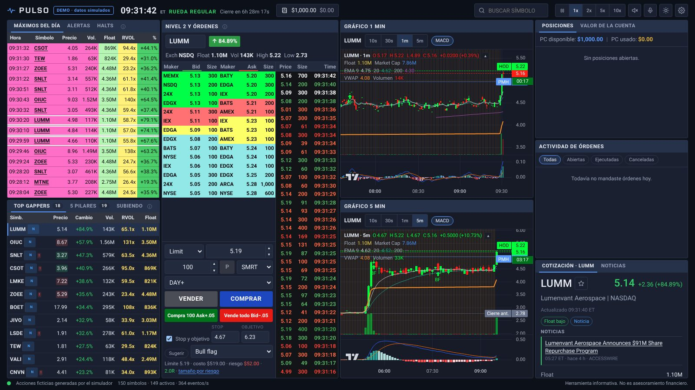
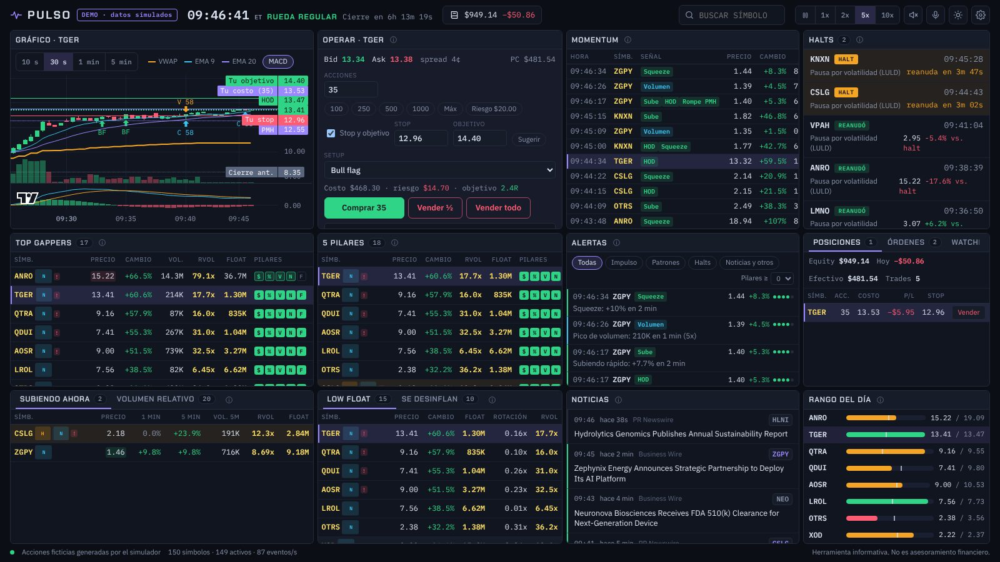
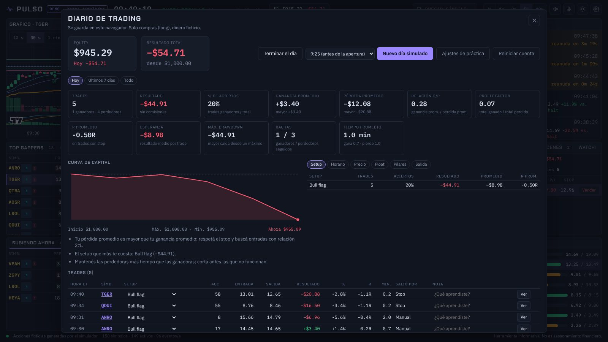

# Pulso: escáner de momentum en tiempo real para small caps de EE.UU.

Escáner de acciones al estilo de Arcane Monitor, pensado para operar momentum como enseña Ross Cameron
(Warrior Trading). Recorre todo el mercado de EE.UU. y te muestra, en una sola pantalla, las acciones que
cumplen los **5 pilares**: precio, suba del día, volumen relativo, noticia y float bajo. Te avisa con
sonido o voz cuando una hace un nuevo máximo, un squeeze, un bull flag, un halt o tiene una noticia.



- **Probarlo sin instalar nada:** modo demo con un mercado simulado (acciones ficticias), en
  https://agustincorreas.github.io/codex-playground/pulso/ (se publica desde `main`).
- **Practicar con plata ficticia:** un simulador de trading realista, en tiempo real, con una cuenta de
  US$ 1.000. La pantalla toma como modelo el simulador de Warrior Trading que usa Ross Cameron: Nivel 2 por
  bolsa, Time & Sales, entrada de órdenes con botones y atajos de teclado, gráficos de 1 y 5 minutos,
  posiciones, actividad de órdenes y una página de métricas con tus estadísticas y el Profit Trifecta.
- **Usarlo con datos reales:** corre en tu computadora y se conecta a **Alpaca** o a **Massive**
  (ex Polygon.io). Hace falta una suscripción de datos; abajo están los costos y cómo sacarla.

> Pulso es una herramienta informativa. No es asesoramiento financiero ni recomienda comprar o vender nada.

---

## 1. Qué muestra

La pantalla está armada con ventanas, como una plataforma de trading. En la computadora se pueden
**reacomodar**: con el botón de ventanas (arriba a la derecha) cada una se mueve desde su barra de título y
cambia de tamaño desde los bordes y las esquinas; **Listo** fija la disposición y **Restablecer** vuelve a
la original. Se guarda en ese navegador, una para pantalla grande (las ventanas ocupan todo el alto, así que
en un monitor grande todo se agranda) y otra para notebook.

| Ventana | Qué es |
| --- | --- |
| **Mis trades** | Arriba del Nivel 2: tu trade abierto en vivo (acciones, precio promedio, ganancia o pérdida en US$ y en %, R, tiempo en el trade y una barra con el precio entre tu stop y tu objetivo) y los trades que ya cerraste hoy con su resultado, más lo realizado en el día. |
| **Máximos del día** | El escáner de momentum: cada señal en una fila, la más nueva arriba (nuevo máximo, squeeze, subida rápida, bull flag, ruptura del máximo del pre-market, pico de volumen), con hora, precio, volumen, float, volumen relativo y % del día. El color de la fila dice cuántos pilares cumple y las celdas que pasan el corte (float bajo, RVOL 5x, +10%) se resaltan. Pestañas **Alertas** (todas, con filtros) y **Halts** (motivo, cuenta regresiva de 5 minutos y % de la reanudación). |
| **Escáneres** | **Top gappers** (suben 5%+ contra el cierre anterior, precio $1–$20, volumen desde 50K), **5 pilares** (cumplen 4 o 5: `$` precio, `%` suba, `V` volumen relativo, `N` noticia, `F` float), **Subiendo** (lo que más sube en 5 minutos), **Low float**, **Volumen relativo**, **Se desinflan** (subieron 20%+ y ya están 15%+ abajo del máximo), **Watchlist** (tus estrellas) y **Rango del día**. |
| **Nivel 2 y órdenes** | El sector de la empresa, el libro de órdenes por bolsa, la cinta (Time & Sales) y la entrada de órdenes de la cuenta de práctica (sección 2). |
| **Gráfico 1 min y 5 min** | Velas de 10 s, 30 s, 1 min, 5 min, 4 horas, diarias (D), semanales (S) y mensuales (M), con historia hacia atrás (todo el día en 10 s con datos reales, 5 días en 1 y 5 min, 100 días en 4 h, desde 2016 en D, S y M), **líneas dibujadas** (horizontales, de tendencia y **alertas de precio** que suenan y se leen cuando el precio las cruza; se guardan por acción en el navegador), con VWAP, EMA 9, 20 y 200, volumen y MACD; leyenda con OHLC, float y capitalización; cuenta regresiva del cierre de la vela; líneas del máximo del día, máximo del pre-market y cierre anterior; marcas de halts y de bull flag. En práctica, además, tus compras (C) y ventas (V), tu costo y tus órdenes. |
| **Cotización** | La ficha de la acción: precio, empresa y bolsa, noticias, float, volumen, volumen relativo diario y de 5 minutos, gap, máximos, VWAP, short interest, capitalización, etiquetas de dilución de la SEC, los 5 pilares con su valor y el estado del setup (VWAP, EMA 9, MACD). Pestaña **Noticias** con todos los titulares. |
| **Posiciones / Trades de hoy / Cuenta** | Las acciones que operaste hoy (abiertas y ya cerradas) con el resultado no realizado, el realizado y el total; cada trade cerrado con lo que ganaste o perdiste y el **resultado del día**; efectivo, plata sin liquidar, poder de compra, cuenta de day trades y **Cambiar saldo**. |
| **Actividad de órdenes** | Todas las órdenes del día con su estado (enviada, abierta, parcial, ejecutada, cancelada o rechazada). |
| **Cuenta y métricas** | Se abre con el botón del saldo, arriba: estadísticas, Profit Trifecta, curva de capital y trades (sección 2). |

En el celular la misma información se ordena en pestañas (Escáner, Alertas, Operar, Cotización y Métricas).
En **Operar**, con el teléfono en vertical, el gráfico queda arriba y abajo hay una **barra de operación
fija** para comprar y vender sin dejar de mirar el precio:
- **La acción elegida:** el último precio, el % del día, y el bid y el ask.
- **Tu posición:** las acciones, el precio promedio y el resultado en vivo.
- **La cantidad:** con − y +, o con atajos. **½** y **Todo** ponen la mitad o toda tu posición. **Máx**
  pone lo máximo que te alcanza.
- **COMPRAR:** compra en el Ask + 0,05 y muestra el precio límite y el costo. Si no te alcanza, el costo
  aparece subrayado.
- **VENDER:** vende esa cantidad en el Bid − 0,05, sin pasarse de tu posición.
- **Cancelar:** aparece cuando tenés órdenes en espera.

El ticket completo (límite a un precio, stop, stop plan y objetivo) sigue más abajo, con el Nivel 2 y la
cinta.

### Los 5 pilares (valores por defecto, se cambian en Ajustes)

| Pilar | Criterio | Por qué |
| --- | --- | --- |
| Precio | Entre US$ 1 y US$ 20 | El rango donde se mueven los small caps con momentum. |
| Ya sube | 10% o más en el día | Muestra que hay demanda real. |
| Volumen relativo | 5x o más | Se calcula contra lo normal **a esta hora** (a las 9:00 nadie hizo el volumen de un día entero). |
| Noticia | Titular en las últimas 24 h | El catalizador que explica la suba. |
| Float | Menos de 10M de acciones | Poca oferta: el precio se mueve rápido. Hasta 20M es aceptable. |

### Alertas

**Alertas de precio tuyas:** en el gráfico, el botón 🔔 pone una línea en el precio que toques; cuando el precio
la cruza (hacia arriba o hacia abajo) suena, se lee en voz alta y entra en la lista de alertas, una sola vez. Con
─ se dibuja una línea horizontal sin alerta y con ╱ una línea de tendencia (dos toques), en blanco; *Líneas* las
lista, les prende o apaga la alerta y las borra. Esc cancela el dibujo. Las acciones con alerta se siguen aunque no
estén en ningún escáner.

Nuevo máximo del día (con o sin volumen), cerca del máximo, subida rápida (+5% en 2 min), squeeze (cada
+10% en 15 min), pico de volumen (5x el promedio del minuto), compras apiladas (10 subas seguidas),
ruptura del máximo del pre-market, ruptura de medio dólar / dólar entero, **bull flag** (palo con volumen,
retroceso de 1 a 4 velas con menos volumen que no devuelve más del 50%, sobre el VWAP: avisa en la primera
vela que hace nuevo máximo y propone entrada, stop y objetivo 2:1), recupera / pierde el VWAP, rojo a verde,
flush (−12% en 5 min), halt, reanudación, noticia, entra a gappers y rotación del float (volumen ≥ float).

Las alertas suenan y las de momentum (nuevo máximo, squeeze, subida rápida, bull flag, ruptura del máximo
del pre-market, pico de volumen) y los halts se leen en voz alta: "V I O. Squeeze. Sube 45 por ciento". Si
llegan varias juntas suena la más importante, y la misma acción no se repite antes de 45 segundos. El
navegador exige un toque antes de reproducir audio: al abrir la página, tocá cualquier parte. El botón
**Voz** de *Máximos del día* y los del parlante y el micrófono, arriba, las apagan; en Ajustes elegís qué
alertas suenan y desde cuántos pilares.

---

## 2. Modo práctica: un simulador realista con US$ 1.000 ficticios

Como conectarse a datos reales cuesta plata, Pulso trae un **mercado simulado en tiempo real** y una
**cuenta de práctica** para operarlo. La pantalla y la forma de operar toman como modelo el simulador de
Warrior Trading que usa Ross Cameron: las mismas ventanas, el Nivel 2 con colores por nivel de precio, la
cinta, los botones y los atajos de teclado. (Es solo un modelo visual: Pulso no tiene relación con Warrior
Trading.) Las acciones son ficticias pero se comportan como small caps de momentum: gaps con noticia,
squeezes, bull flags, halts por volatilidad y acciones que se desinflan. Todo pasa en el navegador: no hay
que instalar nada.



### El mercado simulado

- **Cada operación tiene un agresor:** las compras pagan el ask y las ventas toman el bid; las órdenes grandes
  barren varios niveles (en la cinta aparecen arriba del ask o debajo del bid). Hay lotes impares y cruces
  en el medio del spread, como en la cinta real.
- **Bid y ask (NBBO) que se mueven con el precio.** El spread es más ancho en las acciones baratas, en el
  pre-market, en los movimientos rápidos y al reanudar un halt.
- **Nivel 2 por bolsa** (NSDQ, ARCA, EDGX, BATS, MEMX, IEX y otras) armado alrededor del NBBO, con paredes en
  los dólares y medios dólares. Lo que compran o venden los demás (y vos) lo consume, y se repone.
- **Halts por volatilidad** de 5 minutos y reanudación.
- Las acciones "en juego" (suben 15% o más) siguen operando con volumen aunque ya no estén corriendo.
- La cinta arranca con los últimos 3 minutos de operaciones, como cuando abrís un símbolo en una plataforma.
- **El volumen de cada hora:** casi nada a las 4:00, sube hacia la apertura (más desde las 7:00, cuando se
  suman los brókers minoristas), la apertura es lo más fuerte del día, el mediodía flojo y repunta al cierre.
  El **after-hours** (16:00 a 20:00) es muy fino: algo en la primera hora, con **balances** que mueven a
  alguna acción, y casi nada después. Las acciones con noticia operan mucho más en el pre-market que el resto.
- **Días distintos:** cada día puede salir **frío** (3 o 4 gappers y corridas cortas), **normal** o
  **caliente** (9 a 12 gappers y corridas más grandes y seguidas). Después de un fin de semana o de un
  feriado hay 2 gappers más (se juntaron noticias). Los días de cierre anticipado (13:00) también se respetan.
- **Ofertas de acciones (dilución):** una empresa que viene subiendo fuerte puede anunciar una oferta
  ("Registered Direct Offering", "Public Offering"…) y la acción se desploma 20% a 40% en minutos. Es más
  probable si tiene un shelf (S-3) o warrants, como en el mercado real: mirá las etiquetas de dilución.

### Un día de práctica

1. **Elegís cómo practicar** con el botón del día, al lado del reloj (o *Cuenta y métricas → Nuevo día*):
   - **Mercado ahora:** la hora real de Nueva York, con pre-market desde las 4:00, la rueda de 9:30 a 16:00 y
     el after-hours hasta las 20:00. No se puede pausar ni acelerar. Si cerrás la página (o la compu se
     duerme), al volver el mercado se pone al día con la hora actual y es el mismo que estabas viendo; si
     dejaste órdenes en espera, antes se repasa lo que pasó mientras no estabas, así se ejecutan (o salta el
     stop) como en el mercado, y te avisa. Ese día el mercado es el mismo para todos los que lo usan. Fines
     de semana, feriados y de 20:00 a 4:00 está cerrado: te dice cuándo abre y mientras tanto podés practicar
     con un día simulado.
   - **Día de práctica:** un día simulado en la **fecha** y a la **hora** que quieras (de 4:00 a 19:30 ET,
     con atajos para el pre-market, la apertura, el mediodía, la última media hora y el after-hours). El
     día arranca con todo lo anterior ya armado. Con 2x, 5x o 10x el reloj corre más rápido y con ⏸ se pausa.
   - **Repetir un día:** el mismo mercado de un día que ya practicaste, desde la misma hora (en el diálogo o
     con **Repetir** en *Días anteriores*). Sirve para volver a operar un día que te salió mal.

   Los gappers, las noticias, los halts y las ofertas salen al azar: cada día nuevo es distinto.
2. Elegís una acción en *Máximos del día* o en los escáneres, o escribís el símbolo en la ventana *Nivel 2
   y órdenes*.
3. **Entrada de órdenes:** tipo (*Limit*, *Market* o *Stop*), precio (las flechas lo mueven de a un tick y
   tocando un nivel del libro se copia su precio), cantidad (de a 100; **P** pone el tamaño de tu
   posición), ruta, vigencia (**DAY+** opera también en pre-market y after-hours; **DAY** solo en la rueda)
   y **VENDER** / **COMPRAR**.
4. **Las salidas las hacés vos.** La compra sale sola, sin stop ni objetivo automáticos: el *Stop plan* y el
   *Obj. plan* del ticket son tu plan (el stop mental). Sirven para el **tamaño por riesgo** (cuántas
   acciones comprar para perder como mucho tu riesgo por trade, que por defecto es el 2 % de la cuenta
   y crece y baja con ella; las acciones que propone el ticket también salen de la cuenta, el 25 % de su
   valor al precio de la acción; los dos se cambian en los ajustes, o se fijan en un número), para medir la R de cada
   trade y se ven punteados en el gráfico, pero no se mandan como órdenes. El stop propuesto va debajo del
   mínimo del retroceso (o en el stop del bull flag si hay uno armado), nunca más pegado que el rango típico
   de una vela de 1 minuto, y el objetivo a 2R; acompaña al precio mientras no lo cambies a mano y
   **Sugerir** lo vuelve a calcular.
   Si preferís que se pongan solos, tildá **Stop y objetivo automáticos (OCO)** (o en *Ajustes de la cuenta
   → Órdenes y costos*): la compra sale con un stop de pérdida y una venta límite en el objetivo, que se
   cancelan entre sí.
5. Para entrar y salir rápido están los **botones rápidos** (abajo de COMPRAR/VENDER) y los **atajos de
   teclado**. Con una posición abierta aparecen **Stop a BE** (pone el stop en tu precio de entrada) y
   **Poner stop/obj.** (coloca los del ticket como órdenes); en *Posiciones*, **Cerrar** vende todo.
6. Cada orden suena distinto, como en TradingView: compra ejecutada (dos notas que suben), venta (dos que
   bajan), trade cerrado con ganancia o con pérdida, ejecución parcial, orden en espera, cancelada y
   rechazada, con un aviso en pantalla. Se apagan en *Ajustes de la cuenta → Órdenes y costos*, donde también
   podés escucharlos.
7. En *Posiciones* quedan también las acciones que ya cerraste, con lo que ganaste o perdiste en cada una, y
   la pestaña **Trades de hoy** lista cada trade con su resultado y el **total del día** (el saldo de arriba
   también muestra el resultado de hoy).
8. El día sigue en el after-hours hasta las 20:00 ET (17:00 en los días de cierre anticipado): un minuto
   antes se cierra solo (vende lo que quedó abierto), o lo cerrás antes con *Terminar el día*. El saldo pasa
   al día siguiente. En el after-hours solo se aceptan órdenes límite DAY+ y el spread es más ancho.
9. **El saldo lo cambiás cuando quieras:** en la pestaña *Cuenta* (o en *Ajustes de la cuenta → Cuenta*),
   **Cambiar saldo** con el monto que quieras o con los botones de US$ 1.000 a US$ 50.000. Cuenta como un
   depósito o un retiro: el resultado del día, el total y las estadísticas no lo suman como ganancia (con una
   posición abierta hay que cerrarla antes).

### Atajos de teclado

Funcionan con la acción elegida y no actúan mientras escribís en un campo. En *Ajustes de la cuenta → Atajos
de teclado* se cambia la tecla (tocás la casilla y apretás la combinación nueva), qué hace cada uno, se
agregan nuevos y se elige cuáles aparecen como botón rápido.

| Tecla | Qué hace (por defecto) |
| --- | --- |
| ⇧1 | Compra las acciones del ticket a Ask + 0,05 (también es botón rápido) |
| ⇧2 | Compra por riesgo (las acciones que dan US$ 20 hasta el stop) a Ask + 0,05 |
| ⇧3 / ⇧4 | Compra 100 / 500 acciones a Ask + 0,05 |
| ⇧Q / ⇧W / ⇧E | Vende ¼ / ½ / toda la posición a Bid − 0,05 (⇧E también es botón rápido) |
| ⇧R / ⇧T | Vende ½ / toda la posición en el ask (orden límite que espera) |
| ⇧B | Pone (o mueve) el stop en tu precio de entrada |
| Esc | Cancela las órdenes de la acción |

Ask + 0,05 y Bid − 0,05 son órdenes límite que se ejecutan enseguida pero no pagan cualquier precio (así
vienen los botones del simulador de Warrior Trading), y además funcionan en el pre-market, donde no se
aceptan órdenes a mercado.

### Qué tan real es la ejecución

- **Latencia:** cada orden tarda entre 100 y 240 ms en llegar (150 ms de base, se cambia en los ajustes) y se
  ejecuta contra el mercado de ese momento, no contra el precio que viste al apretar.
- **Libro:** a mercado (o con un límite que cruza el spread) se recorre el libro nivel por nivel. Si comprás
  más de lo que hay en el ask, el resto se paga al nivel siguiente y te queda un precio promedio.
- **Fila:** una orden límite que espera tiene adelante las acciones que ya estaban a ese precio. Se ejecuta
  cuando la cinta opera ese volumen a tu precio, o cuando opera más allá (eras la mejor punta). Puede quedar
  ejecutada en parte.
- **Stops:** se disparan con el último precio (una operación en tu stop o peor) y salen contra el bid. Fuera
  de la rueda salen como límite 3% peor.
- **Pre-market y after-hours:** solo órdenes límite, como en los brókers reales. Una orden DAY espera las 9:30
  y vence a las 16:00.
- **Halts:** no se ejecuta nada; las órdenes esperan la reanudación.
- **Costos:** en cada venta, la tasa de la SEC (US$ 20,60 por millón vendido) y la TAF de FINRA
  (US$ 0,000195 por acción, máximo US$ 9,79), redondeadas al centavo hacia arriba. Las comisiones por acción
  (con mínimo por orden) son opcionales.
- **Cuenta cash** (por defecto): lo que vendés hoy se liquida al día siguiente (T+1), así que esa plata no se
  puede volver a usar hasta el próximo día simulado. No tiene regla PDT.
- **Cuenta margen:** poder de compra 2x (4x con US$ 25.000 o más) y regla PDT: con menos de US$ 25.000, como
  máximo 3 day trades en 5 días.
- **Pérdida máxima del día** opcional: al llegar, no te deja abrir nuevas posiciones.
- Se rechazan los precios a más de 50% del último (un dedo de más). Solo compras (long), sin cortos: es el
  estilo de Ross Cameron en small caps.

Todo esto se cambia en *Ajustes de la cuenta* (botón en *Valor de la cuenta* o en *Cuenta y métricas*):
saldo inicial, tipo de cuenta, apalancamiento, pérdida máxima, acciones y riesgo por defecto, vigencia,
hora de inicio, latencia, comisiones y tasas.

### Cuenta y métricas

Se abre con el botón del saldo (arriba) o con la pestaña *Métricas* en el celular.



- **Tus aptitudes:** ganancias y pérdidas (relación ganancia/pérdida, resultado bruto y neto, comisiones y
  tasas, promedio por día, % de aciertos), ganadores y perdedores (promedio, tiempo promedio en el trade y el
  mayor de cada uno).
- Trades, profit factor, R promedio, esperanza por trade, máximo drawdown y rachas.
- **Curva de capital** y consejos automáticos: por ejemplo, si tus pérdidas promedio son más grandes que tus
  ganancias, si mantenés las perdedoras más tiempo que las ganadoras o qué horario y qué setup te cuestan plata.
- **Profit Trifecta** de la semana (5 días simulados): % de aciertos, relación ganancia/pérdida y constancia
  (semanas positivas seguidas) suman de 1 a 6 puntos cada uno, y el total da tu nivel.

  | Puntos | % de aciertos | Relación G/P | Semanas positivas seguidas |
  | --- | --- | --- | --- |
  | 1 | 50% o menos | menos de 1:1 | 0 |
  | 2 | 51% | 1:1 | 1 |
  | 3 | 56% | 1,5:1 | 2 |
  | 4 | 61% | 1,75:1 | 3 o 4 |
  | 5 | 66% | 2:1 | 5 |
  | 6 | 71% o más | más de 2,25:1 | 6 o más |

  Niveles: 1–3 no rentable, 4–6 principiante, 7–9 intermedio, 10–13 con experiencia, 14–18 profesional.
- **Rentabilidad** por precio, horario (de a 1 hora, 30 o 15 minutos), gap, volumen, volumen relativo y setup.
- **Rendimiento por semana**, día por día.
- **Desglose** por setup, horario, precio, gap, volumen, volumen relativo, float, pilares y motivo de salida.
- **Lista de trades** con hora, setup, entrada, salida, resultado en US$ y en %, R, minutos y motivo de salida.
  Podés corregir el setup y anotar qué aprendiste; **Ver** abre el gráfico del trade con tus entradas y
  salidas y cuánto llegó a ir a favor y en contra (MFE/MAE). **Exportar todo (CSV)** baja todos tus trades.
- Filtros por hoy, últimos 5 días, todo o un día en particular, y la tabla de días anteriores.

### Dónde se guarda

- **Con el servidor de Pulso (la app de escritorio o `npm start`):** en el servidor, en un solo archivo
  (`cuenta-de-practica.json`, en tu perfil de usuario con la app de escritorio o en `data/` con Node).
  Es **una sola cuenta para todos los dispositivos**: la computadora, el celular por Wi-Fi y cualquier
  navegador que abra ese servidor ven el mismo saldo, las mismas posiciones y el mismo diario, y un
  cambio hecho en uno aparece en los otros al instante. La primera vez, la cuenta que ya tenía el
  navegador pasa sola al servidor. Si el servidor no responde un momento (se está reiniciando), lo que no
  se pudo guardar queda en el navegador y se sube con el próximo guardado.
- **En el artifact de Claude:** en tu cuenta de Claude. Es privado (si compartís el link, cada persona tiene
  su propia cuenta de práctica) y lo ves desde cualquier dispositivo.
- **En la demo de GitHub Pages:** en el navegador. Si borrás los datos del sitio, se pierden.

Si cerrás la pestaña en medio de un día de práctica, al volver se reanuda el mismo mercado en el mismo
segundo, con tus posiciones y órdenes (en "Mercado ahora", en la hora actual de Nueva York).

**Respaldo:** en *Ajustes de la cuenta → Cuenta*, **Exportar la cuenta** baja un archivo con todo (saldo,
ajustes, el día en curso y el diario). Con **Importar un respaldo…** lo cargás en otro navegador o en otra
computadora, por ejemplo en el link público, y seguís igual. Sirve también para no perder nada si borrás los
datos del navegador. Con datos reales (secciones 3 y 4) la misma cuenta de práctica opera sobre el mercado
de verdad: precios y cinta reales, pero el Nivel 2 es una estimación armada alrededor del bid y el ask,
porque el escáner no recibe el libro de órdenes.

---

## 3. ¿Hace falta pagar los datos en tiempo real? Sí. Cuánto sale y cómo se saca

No hace falta suscribirse a la bolsa directamente: se contrata a un **proveedor de datos** que cobra los
derechos de las bolsas (NYSE, Nasdaq, Cboe). Para un particular que opera su propia plata, esos derechos son
la tarifa de **"no profesional"**, que es baja; el proveedor cobra su abono encima. Precios verificados en
octubre de 2026:

| Opción | US$/mes | ¿Tiempo real? | Para qué sirve |
| --- | --- | --- | --- |
| **Alpaca — Algo Trader Plus** | **99** | Sí, SIP (todas las bolsas) | **La opción más barata que cubre todo el mercado.** Incluye halts, LULD y noticias Benzinga en tiempo real. |
| **Massive — Stocks Advanced** | **199** (20% menos pagando anual) | Sí | La más completa: agregados de cada segundo de todas las acciones, snapshot desde las 4:00 ET, float y short interest. Las noticias de Benzinga son un agregado de US$ 99. |
| Massive — Stocks Starter | 29 | No (15 min de demora) | Para probar todo el sistema con datos reales, demorados. |
| **Alpaca — Basic** | **0** | **En capas:** precio en tiempo real de la bolsa IEX (~2–3% del volumen) + el mercado completo con 15 min de demora | **Para ver el mercado real sin pagar.** Los escáneres, el volumen, el RVOL y los máximos usan el mercado completo (con 15 min de atraso); el precio, las alertas y la cinta de IEX van al segundo. Ver "El plan gratis en capas". |
| Massive — Basic | 0 | No (fin del día) | **Float y short interest gratis**: conviene cargar esta clave aunque uses Alpaca. |
| Interactive Brokers | 4,50 (no profesional) | Sí, hasta 100 símbolos a la vez | Excelente como bróker, pero no alcanza para escanear todo el mercado. |

**Recomendación:** Alpaca Algo Trader Plus (US$ 99) + la clave gratis de Massive para el float + los halts
del RSS de Nasdaq y la SEC (gratis, ya incluidos en Pulso). Si Alpaca no te aprueba la cuenta, Massive
Stocks Advanced (US$ 199) funciona solo.

Para comparar con herramientas hechas: Arcane Monitor cuesta US$ 35/mes y no pide una suscripción de datos aparte; Day Trade
Dash de Warrior Trading, US$ 147–197/mes; Trade Ideas, US$ 127–254/mes; Benzinga Pro, US$ 37–197/mes. Armar
el escáner propio sale más en datos que Arcane, pero es tuyo: sin límites, configurable y extensible.

### El plan gratis de Alpaca, en capas

Con la cuenta gratis Pulso arma el mercado con dos capas:

1. **El mercado completo, con 15 minutos de demora** (el SIP demorado que Alpaca da gratis): de ahí salen
   el universo (cierres anteriores), el volumen del día, los máximos y mínimos y, cada un minuto, un
   repaso de todas las acciones. Con eso los escáneres (gappers, RVOL, 5 pilares) ven el volumen real.
2. **La bolsa IEX en tiempo real:** velas de 1 minuto de todas las acciones y prints tick a tick de hasta
   30 símbolos calientes. De ahí salen el precio, las alertas de momentum y la cinta, al segundo.

El motor junta las dos: el volumen del día es el consolidado hasta hace 15 minutos más lo que vio IEX
después, y para el volumen de los últimos 5 minutos escala lo de IEX según cuánto representó del
mercado en los minutos anteriores de esa misma acción (IEX ve ~2 % en el pre-market y apenas 0,5 % en
una small cap caliente en la rueda regular, así que la escala se calibra por acción, minuto a minuto).
Las velas de 1 minuto de todas las acciones se van reemplazando por las consolidadas a medida que pasan
los 15 minutos. En el encabezado dice **EN VIVO (IEX) · MERCADO COMPLETO −15 MIN**, y
`http://localhost:8787/api/symbol?sym=XXXX` muestra cómo se combinan las dos capas para una acción.

Lo que no tiene: el volumen de los últimos 15 minutos es una estimación (IEX ve poco en acciones
ilíquidas), un máximo nuevo del mercado completo tarda 15 minutos en aparecer si IEX no lo vio, y la
cinta es solo la de IEX. Para operar en serio sigue haciendo falta el SIP en tiempo real (abajo).

### Cómo sacar Alpaca (US$ 99/mes)

1. Creá la cuenta en https://app.alpaca.markets con tu email. Te da una cuenta *paper* (simulada), las claves
   de API y los datos gratis de IEX: con eso ya podés probar Pulso (`ALPACA_FEED=iex`).
2. Para contratar los datos completos Alpaca pide **abrir la cuenta real** (no hace falta operar con ella):
   pasaporte, comprobante de domicilio, tu CUIT/CUIL como identificación fiscal y el formulario W-8BEN.
   Alpaca no publica una lista de países; si te rechaza el país, escribí a support@alpaca.markets.
3. En el dashboard: **Plans & Features → Market Data → Algo Trader Plus**. Se paga con tarjeta internacional
   en dólares (tu banco puede sumar percepciones por consumos en el exterior).
4. Las claves son las mismas: reiniciá Pulso y detecta solo el plan (`ALPACA_FEED=auto`). Si el feed SIP no te autoriza con las
   claves de paper, generá las de la cuenta real (Pulso detecta solo a qué servidor corresponden).

### Cómo sacar Massive (US$ 199/mes, o gratis solo para el float)

1. Creá la cuenta en https://massive.com: la clave gratuita (Basic) ya da float y short interest.
2. Para tiempo real, contratá **Stocks Advanced**. Respondé con cuidado el cuestionario de "no profesional":
   no se puede revertir.
3. **Firmá los acuerdos de las bolsas** en el dashboard; sin eso los datos llegan demorados.
4. En `.env`: `MASSIVE_API_KEY=...` y `MASSIVE_PLAN=advanced` (o `starter` para probar con demora).

### Profesional o no profesional

Sos **no profesional** si operás tu propia plata, a tu nombre, sin estar registrado ante la SEC, la CNV u
otro regulador y sin manejar dinero de terceros. Ser profesional multiplica el costo de cada bolsa (US$ 25–45
por bolsa por mes en vez de ~US$ 1). Desde abril de 2027 (nuevo plan del consolidated tape) operar a través
de una sociedad también cuenta como uso profesional.

**Importante:** los planes personales son para uso propio. Mostrar los datos a otros (transmitir la pantalla
en YouTube o Discord, o vender acceso como hacen Arcane o Stocks Rocks) es *redistribución* y requiere
licencias de las bolsas (desde ~US$ 1.000/mes por bolsa) y planes comerciales del proveedor (por ejemplo,
Massive Business desde US$ 2.499/mes).

Fuentes: [Alpaca, planes de datos](https://docs.alpaca.markets/docs/about-market-data-api) ·
[Massive, precios](https://massive.com/pricing) · [Massive, float](https://massive.com/docs/rest/stocks/fundamentals/float) ·
[IBKR, datos de mercado](https://www.interactivebrokers.com/en/pricing/market-data-pricing.php) ·
[Arcane Monitor](https://www.arcanemonitor.com/pricing) · [Day Trade Dash](https://www.warriortrading.com/day-trade-dash/) ·
[Trade Ideas](https://www.trade-ideas.com/pricing/) · [Plan UTP (no profesional)](https://www.utpplan.com/DOC/Datapolicies.pdf).

---

## 4. Instalación

### La forma fácil: la app de escritorio (Windows y Mac)

En [Releases](https://github.com/agustincorreas/codex-playground/releases) está el instalador: `Pulso-…-Windows-instalador.exe`
o `Pulso-…-Mac.dmg` (sirve para Intel y Apple Silicon). Se instala como cualquier programa, abre una
ventana propia y arranca el servidor solo. La primera vez pide las claves (Alpaca gratis para el mercado
real, Massive gratis para el float); sin claves corre el simulador. Las claves y la caché quedan en tu
perfil de usuario, nunca en la app, igual que la cuenta de práctica (`cuenta-de-practica.json`, con una
copia anterior `.bak`). Desde el menú *Pulso*: cambiar las claves, reiniciar el servidor, copiar la
dirección para el celular (misma Wi-Fi: ve la misma cuenta de práctica) y ver el registro.

La app no está firmada (firmarla cuesta ~US$ 99 por año en cada plataforma), así que la primera vez:

- **Windows:** "Windows protegió tu PC" → *Más información* → *Ejecutar de todas formas*.
- **Mac:** arrastrá Pulso a Aplicaciones y abrila con **clic derecho → Abrir**. Si igual la bloquea,
  *Ajustes del Sistema → Privacidad y seguridad → Abrir de todos modos*.

Para armar los instaladores: un tag `pulso-vX.Y.Z` dispara el workflow `desktop.yml`, que los compila en
GitHub Actions (Windows y Mac) y los publica en el Release. A mano: `npm run build:desktop` y, en
`desktop/`, `npm ci && npx electron-builder`.

### A mano, con Node (una vez, ~10 minutos)

1. Instalá **Node.js 20 o más nuevo** desde https://nodejs.org (botón "LTS").
2. Bajá el código (botón verde **Code → Download ZIP** en GitHub, o `git clone`) y abrí una terminal en la
   carpeta `pulso`.
3. Instalá y arrancá:

```bash
cd pulso
npm install
cp .env.example .env      # en Windows: copy .env.example .env
npm start
```

4. Abrí http://localhost:8787. Sin claves arranca en **modo demo** (mercado simulado en el servidor).
5. Completá `.env` con tus claves (ver la sección 3) y reiniciá con `npm start`. En la consola vas a ver el
   progreso: lista de acciones, snapshots, volumen promedio, velas del día y la conexión al streaming. Las
   claves quedan en tu computadora: la interfaz nunca las recibe.

**Desde el celular:** poné `HOST=0.0.0.0` en `.env`, reiniciá y abrí `http://IP-DE-TU-PC:8787` con el
celular conectado a la misma red Wi-Fi.

| Variable | Para qué |
| --- | --- |
| `ALPACA_KEY_ID`, `ALPACA_SECRET_KEY`, `ALPACA_FEED` | Alpaca (`auto` = detecta el plan al arrancar, `iex` = plan gratis en capas, `sip` = pago). |
| `ALPACA_DELAYED_POLL_SEC`, `ALPACA_HOT_REFRESH_SEC` | Plan gratis: cada cuánto se repasa el mercado completo demorado (60) y se completan las velas consolidadas de los símbolos calientes (300). |
| `PULSO_DATA_DIR` | Carpeta de la cuenta de práctica (`cuenta-de-practica.json`); por defecto `data/`. La app de escritorio usa tu perfil de usuario. |
| `MASSIVE_API_KEY`, `MASSIVE_PLAN` | Massive (`basic`, `starter`, `developer` o `advanced`). |
| `SEC_USER_AGENT` | "Tu Nombre tu@email.com": activa las etiquetas de dilución de la SEC (S-1, shelf S-3, 424B, 8-K 3.02) y las acciones en circulación. |
| `FMP_API_KEY`, `FLOAT_CSV` | Fuentes alternativas de float (Financial Modeling Prep o tu propio CSV). |
| `UNIVERSE_MIN_PRICE`, `UNIVERSE_MAX_PRICE` | Rango de precio de las acciones que se siguen (por defecto $0,20–$60). |

Cada día a las 4:00 ET el servidor recarga los cierres y el volumen promedio solo. Las descargas pesadas
(volumen promedio, float) se guardan en `pulso/.cache` para que reiniciar sea rápido.

### De dónde sale cada dato

| Dato | Alpaca | Massive |
| --- | --- | --- |
| Precios y volumen | Velas de 1 min de todo el mercado + prints tick a tick de las ~400 acciones calientes | Agregados de 1 s de todo el mercado |
| Cierre anterior y volumen promedio | Snapshots + velas diarias de 30 ruedas | Cierres diarios agrupados de 30 ruedas + snapshot |
| Halts | Canal `statuses` + RSS de Nasdaq | RSS de Nasdaq + LULD |
| Noticias | Benzinga en tiempo real (websocket) | API de noticias de Massive (cada 3 min) |
| Float / short interest | Massive gratis, FMP o CSV; si no hay, acciones en circulación de la SEC (≈) | Massive |
| Dilución | SEC EDGAR (si definís `SEC_USER_AGENT`) | SEC EDGAR |
| Sector | Massive gratis (ficha del ticker) o SEC EDGAR | Massive |
| Historia del gráfico | Velas de 1 min, 1 hora y diarias (ajustadas por splits) | Agregados de 1 min, 1 hora y diarios |

---

## 5. Cómo se usa con el método de los 5 pilares

1. **Pre-market (7:00–9:30 ET):** mirá *Top gappers* y *5 pilares*. Abrí la ficha de cada candidata: noticia,
   float, RVOL y etiquetas de dilución (un 424B o un S-1 reciente suele significar que la empresa está
   vendiendo acciones). Marcá con la estrella las mejores y fijate el máximo del pre-market en el gráfico.
2. **Apertura (9:30–11:00 ET):** el panel *Momentum* y las alertas sonoras te avisan cuando una de esas
   acciones hace un nuevo máximo, un squeeze o arma un bull flag. Los halts al alza y su reanudación aparecen
   en *Halts* con la cuenta regresiva.
3. **Antes de entrar:** revisá el *Setup* de la ficha (sobre el VWAP, sobre la EMA 9, MACD a favor) y armá la
   orden en el ticket: con el stop en el mínimo del retroceso, el botón *Riesgo* te dice cuántas acciones
   comprar para no perder más que tu máximo, y la línea de abajo muestra si el objetivo da 2:1. Si no hay un
   2:1 razonable, no hay trade.

Para practicar sin arriesgar plata está el modo práctica (sección 2). Ross Cameron recomienda practicar en
simulador hasta que las estadísticas den positivas de forma consistente antes de operar con plata real.

---

## 6. Para desarrolladores

```
pulso/
  src/engine/   motor del escáner (sin dependencias: corre igual en el navegador y en Node)
    engine.ts     estado por símbolo, escáneres, halts, noticias, ficha
    alerts.ts     reglas de alerta y detección de bull flag
    metrics.ts    RVOL ajustado por horario, 5 pilares, filas de los escáneres
    symbol.ts     velas de 1 min, VWAP, EMA/MACD incrementales
    time.ts       hora ET, sesiones, feriados NYSE 2025–2027, curva de volumen intradía
  src/sim/      mercado simulado (gappers, runners con noticia, ofertas, halts LULD, fades, volumen por hora,
                días fríos y calientes); el camino de cada acción depende solo de la semilla y del día, así
                que se rearma igual a cualquier hora
  src/trading/  cuenta de práctica (sin dependencias)
    broker.ts     órdenes a mercado, límite y stop, latencia, fila, OCO, halts, cash T+1, margen y PDT, tasas
    depth.ts      Nivel 2 por bolsa alrededor del NBBO
    stats.ts      métricas, Profit Trifecta, curva de capital y desgloses
    store.ts      guardado en el navegador o en la base del artifact de Claude
  src/client/   interfaz React + lightweight-charts (TradingView)
    training.ts   días de práctica y "Mercado ahora": crear, reanudar, ponerse al día, repetir, terminar,
                  cambiar el saldo, guardar, exportar e importar
    lib/hotkeys.ts  atajos de teclado configurables
    components/WindowGrid.tsx  ventanas reacomodables (react-grid-layout)
  server/       servidor Node: Alpaca, Massive, halts de Nasdaq, SEC, float; WebSocket hacia la interfaz
  desktop/      app de escritorio (Electron): ventana, servidor como proceso hijo, pantalla de claves; electron-builder
  test/         pruebas (motor, adaptadores con mensajes de la documentación oficial, servidores falsos)
```

| Comando | Qué hace |
| --- | --- |
| `npm run dev` | Interfaz en modo demo con recarga en caliente (http://localhost:5173). |
| `npm start` | Compila la interfaz y arranca el servidor (datos reales si hay claves). |
| `npm test` | Pruebas (109): motor, alertas, bull flag, halts, Alpaca y Massive contra servidores falsos, simulador (el mismo mercado a cualquier hora, volumen por hora, días, ofertas, after-hours), el plan gratis de Alpaca en capas, la detección del plan, bróker de práctica, días de práctica, respaldo, la cuenta guardada en el servidor, riesgo según la cuenta, temporalidades largas e historia, líneas y alertas de precio, y métricas. |
| `npm run typecheck` | Chequeo de tipos de todo el proyecto. |
| `npm run build:demo` | Página única del demo (`dist-demo/index.html`) para GitHub Pages. |
| `npm run build:desktop` | Interfaz + servidor en un solo archivo para la app de escritorio (`desktop/app/`). |

### Límites conocidos

- Con el plan gratis de Alpaca, el volumen de los últimos 15 minutos es una estimación a partir de IEX y la
  cinta es solo la de esa bolsa: sirve para ver el mercado real y practicar, no para operar con plata.
- El float de los proveedores se actualiza con demora; después de un split inverso o una oferta puede estar
  desactualizado unos días. Las acciones en circulación de la SEC no se ajustan por splits (se muestran con ≈).
- Las etiquetas de dilución son heurísticas sobre los formularios presentados a la SEC: confirmá leyendo el filing.
- El bull flag es una detección automática simple sobre velas de 1 minuto. Es una ayuda para mirar, no una señal de compra.
- El simulador sirve para entrenar la lectura del gráfico y de la cinta, la disciplina y el manejo del
  riesgo, pero sus movimientos los genera un modelo: tus órdenes consumen el libro pero no mueven el precio,
  y la ejecución es una aproximación. Un resultado positivo en práctica no garantiza el mismo resultado con
  plata real.
